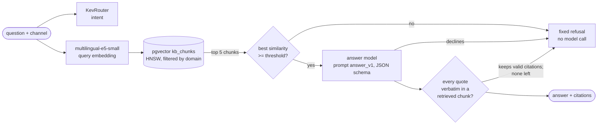

# RAG layer: cited answers

`POST /answer` answers a customer's question from a small knowledge base and shows its sources. The knowledge base in
[`kb/`](../kb/README.md) is **synthetic**: 58 short help articles (29 topics, each in English and Nepali) about refunds,
failed top-ups, KYC, limits, card blocks and deliveries for the same fictional shop, wallet and bank. Every policy,
fee and time in it was written for this demo; none describes a real company.



1. The router gives the intent; the channel picks the domain, and retrieval reads only that domain's chunks.
2. If the best chunk is less similar than the threshold in `configs/rag.yaml`, the answer is a fixed refusal in the
   question's language, with no model call.
3. Otherwise the answer model (Claude through the Anthropic API, behind a small interface with a fake for the tests)
   gets the question and the chunks, with the versioned prompt
   [`configs/prompts/answer_v1.md`](../configs/prompts/answer_v1.md). It must answer in the question's script, use only
   the chunks, and quote each one it relies on. It may decline.
4. The service keeps only citations that quote a retrieved chunk verbatim; an answer left without one is refused.

```bash
docker compose up --build       # also runs the ingest step; /answer needs ANTHROPIC_API_KEY in .env
curl -X POST localhost:8000/answer -H 'Content-Type: application/json' \
     -d '{"text": "mero paisa katyo tara recharge bhayena", "channel": "wallet"}'
```

```json
{"channel": "wallet", "intent": "identity_verification", "refused": false, "refusal_reason": null,
 "answer": "Recharge fail bhaera pani wallet bata paisa katiyo bhane 24 ghanta bhitra aafai wallet ma firta aauchha. Top-up Pending dekhaayo bhane pheri prayas garnu aghi badhima 2 ghanta parkhanuhos, natra paisa dui patak katna sakchha. ...",
 "citations": [{"chunk_id": "wallet-failed-topup-ne#27d2d2caeea8", "doc_id": "wallet-failed-topup-ne",
                "quote": "मोबाइल रिचार्ज वा डाटा प्याक टप-अप फेल भएर पनि वालेटबाट पैसा काटिएमा २४ घण्टाभित्र आफैं वालेटमा फिर्ता हुन्छ।"}, ...],
 "retrieval_scores": [{"chunk_id": "wallet-failed-topup-ne#27d2d2caeea8", "doc_id": "wallet-failed-topup-ne", "score": 0.8328}, ...],
 "prompt_version": "answer_v1", "answer_model": "claude-opus-5-5",
 "latency_ms": {"route": 4119.5, "retrieve": 361.0, "generate": 7555.6, "total": 12036.7}}
```

Retrieval found the right article for the message the router alone was unsure of (the intent above is the router's
low-confidence guess). An out-of-scope question ("What interest rate do you give on a 1-year fixed deposit?", bank)
came back `"refused": true, "refusal_reason": "low_similarity"` after 60 ms of retrieval and no model call.

```bash
uv run python -m nepkev.rag.ingest      # idempotent: embeds only new or edited chunks, deletes removed ones
uv run python -m nepkev.rag.eval        # rebuilds eval/report.md from cached model outputs; --yes to call the API
uv run python -m nepkev.rag.compare     # the embedding model comparison below
```

## Embedding model

Three open multilingual models were compared on the evaluation questions, in memory
([`eval/embedders.md`](../eval/embedders.md)). On dev:

| model | dim | recall@1 | recall@5 | MRR | separates must-refuse (AUC) | ms per query (CPU) |
|---|---|---|---|---|---|---|
| `intfloat/multilingual-e5-small` | 384 | 0.769 | 1.000 | 0.873 | 0.992 | 23 |
| `intfloat/multilingual-e5-base` | 768 | 0.731 | 0.923 | 0.836 | 1.000 | 48 |
| `BAAI/bge-m3` | 1024 | 0.885 | 1.000 | 0.920 | 0.915 | 182 |

`multilingual-e5-small` is used. It ties BGE-M3 on recall@5, which is what the answer model sees, separates
must-refuse questions better, and is 8x faster and a fifth of the size. BGE-M3 ranks the answering article first
more often (also on test: recall@1 0.872 vs 0.795), so it is the upgrade to try if the top chunk matters more.

## Results

From [`eval/report.md`](../eval/report.md), produced by `python -m nepkev.rag.eval`. The question set
([`eval/rag_set.jsonl`](../eval/rag_set.jsonl)) has 126 hand-written questions in English, Devanagari and Romanized
Nepali, 22 of them out of scope (not covered by the knowledge base, or not support questions). A fixed third (dev, 31)
is used only to choose the threshold; the numbers below are on the other 95 (test: 78 answerable, 17 must refuse).
95% intervals are bootstraps over topics, so a question's paraphrases in the three scripts are resampled together.

| retrieval (top 5 of the domain) | test |
|---|---|
| recall@5 | 0.936 [0.867, 0.987] |
| MRR@10 | 0.862 [0.784, 0.925] |
| recall@5 by script: English / Devanagari / Romanized | 1.000 / 0.917 / 0.885 |

| answers (`claude-opus-5-5`, prompt `answer_v1`) | test |
|---|---|
| refusal recall (out-of-scope questions refused) | 0.941 [0.789, 1.000] |
| refusal precision (refusals that were right) | 0.762 [0.562, 0.941] |
| answerable questions answered | 0.936 [0.880, 0.984] |
| citations quoting their chunk verbatim, as the model returned them (222) | 1.000 |
| answers citing an article that answers the question | 0.959 [0.913, 1.000] |
| answers judged supported by their cited chunks (74) | 0.973 [0.938, 1.000] |
| retrieval latency p50 / p95 | 29 / 43 ms |
| answer generation latency p50 / p95 | 5,303 / 8,988 ms |

The support judge is `claude-sonnet-5-5` with the rubric in `configs/prompts/judge_v1.md`. Its verdicts were checked
by hand on 22 answers, 20 taken at a fixed stride plus the 2 it did not call supported; all 22 agree
([`eval/judge_check.jsonl`](../eval/judge_check.jsonl)). The 2 partly supported answers add advice the article does not
give. Answers and verdicts are committed (`eval/answers.jsonl`, `eval/judge.jsonl`).

**How the threshold was chosen.** On dev, the cut-off that keeps every answerable question and refuses as many
must-refuse ones as possible (0.8030). A first version maximised balanced accuracy on dev instead. On test it would
have refused 15% of answerable questions, so it was replaced: a question the gate wrongly refuses is lost, while one
it wrongly lets through still meets the model, which can decline it. With E5's narrow similarity range, the gate
alone separates poorly (test: refuses 6 of 17 out-of-scope questions and 3 of 78 answerable ones). Of the 16 correct
refusals, the gate made 6 and the model 10.

**Known failure cases** (all wrong refusal decisions on test are listed in the report):

- Romanized Nepali is the weakest script for retrieval (recall@5 0.885, recall@1 0.692 vs 0.929 for English).
  "rahadani le kyc garna milcha?" (passport for KYC) and "atm le paisa diyena, ... complain kasari garne?" were
  refused at the gate although their articles exist.
- The model declined two answerable Romanized questions whose answer was in the retrieved chunks: a 60,000 transfer
  against the 50,000 single-transaction limit, and limits for transfers between one's own accounts.
- "kathmandu ma aaja pani parcha?" (will it rain in Kathmandu today?), asked in the shop channel, was read as "will it
  arrive today too?" and answered with delivery times: correctly cited, but not what was asked.
- The questions were written by the same author as the articles, so they share its wording more than real customers
  would, and the set is small; the intervals above are wide for that reason.

**CI gate.** The `rag-gate` job ingests the knowledge base with the real embedding model into a pgvector service
container and runs `python -m nepkev.rag.eval --retrieval-only --check eval/baseline.json`, which fails when test
recall@5 (0.936) or the gate's refusal recall (0.353) drops below the committed baseline. It makes no API calls.
